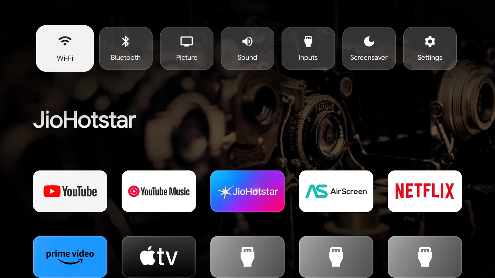

# Driftwood

A quiet home screen for Android TV and Google TV. One row of your apps, a photo that slowly drifts behind them, the time and the weather. Nothing else.

I built it because the stock home screen felt slow and crowded with ads, and I wanted something closer to how the Apple TV home screen feels.


## What you get

- **Your apps in a clean 5-wide grid.** TV apps show their full banner, phone-only apps get a tile coloured from their icon.
- **A new photo every two minutes.** Bing's photo of the day (8 a day) or Unsplash, with a slow zoom and drift. The caption sits small in the corner.
- **Weather** for where you are, worked out from your connection. You can type a city instead.
- **A calm focus style.** The selected app lifts a little inside a thin glass edge with a soft glow, and a light sweep passes over it.
- **A sticky top bar.** Scroll down and the time, date and weather stay at the top while the shelf fades away.
- **Quick settings.** Press Up from the top row for Wi-Fi, Bluetooth, picture, sound, inputs, screensaver and settings.
- **Evening mode.** After sunset (real sunset times for your location) the wallpaper dims and warms, and the screensaver goes darker.
- **HDMI tiles** that switch the TV straight to that input. They hide themselves when nothing is plugged in, on TVs that report it.
- **Your own tiles.** Rename any tile or give it a picture of your own.
- **A Search tile** that opens Google Assistant.
- **A screensaver** with the same photos, plus a clock that moves every 30 seconds so nothing burns in.
- **Hold OK on any app** to move, rename, re-picture or hide it, or open its app info.
- **Comes back where you left.** Press Home inside YouTube and you land on the YouTube tile.
- **Updates itself** from this repo's releases, so you only need a computer once.
- **Light on the TV.** No Google Play Services, no tracking and no accounts. App names and banners are cached, and everything stops animating when you open an app, so playback isn't slowed down.

| Quick settings | Scrolled down |
| --- | --- |
|  |  |

| Hold OK on an app | Hold OK on Settings |
| --- | --- |
|  |  |


## Install

You need a Mac, Linux or Windows computer on the same Wi-Fi as the TV, with [adb](https://developer.android.com/tools/releases/platform-tools) installed (`brew install android-platform-tools` on a Mac).

### 1. Turn on network debugging on the TV

1. Open **Settings → System → About** (on some TVs, **Device Preferences → About**).
2. Select **Android TV OS build** seven times until it says you're a developer.
3. Go back and open **Developer options**. Turn on **USB debugging** (and **Network debugging** if it's listed).
4. Note the TV's IP address from **Settings → Network & Internet → your Wi-Fi**.

### 2. Connect from your computer

```bash
adb connect 192.168.1.49:5555
```

Use your TV's IP. A prompt appears on the TV the first time. Tick **Always allow from this computer** and choose **Allow**.

### 3. Install Driftwood

Download `driftwood.apk` from the [latest release](../../releases/latest), then:

```bash
adb install -r driftwood.apk
```

### 4. Make it the Home button

On Google TV the stock home screen takes over the Home button. Turn it off (nothing is deleted) and point Home at Driftwood:

```bash
adb shell pm disable-user --user 0 com.google.android.apps.tv.launcherx
adb shell pm disable-user --user 0 com.google.android.tungsten.setupwraith
adb shell cmd package set-home-activity com.aravi365.driftwood/.MainActivity
```

On older Android TV (not Google TV), the stock launcher is `com.google.android.tvlauncher`. Disable that one instead.

### 5. Use the Driftwood screensaver (optional)

```bash
adb shell settings put secure screensaver_components com.aravi365.driftwood/.DriftwoodDream
```

Or pick **Driftwood** in **Settings → System → Ambient mode / Screen saver**.

### 6. Allow updates and "Most used first" (optional)

```bash
adb shell appops set com.aravi365.driftwood REQUEST_INSTALL_PACKAGES allow
adb shell appops set com.aravi365.driftwood GET_USAGE_STATS allow
```

The first lets Driftwood install its own updates. The second is only needed for the **Most used first** order. TVs hide both switches, which is why this uses adb.

### 7. Make the whole TV feel faster (optional)

```bash
adb shell settings put global window_animation_scale 0.5
adb shell settings put global transition_animation_scale 0.5
adb shell settings put global animator_duration_scale 0.5
```

## Using it

| Do this | To |
| --- | --- |
| **OK** on a tile | Open the app or switch to that HDMI input |
| **Hold OK** on a tile | Move, rename, change picture, hide, or open App info |
| **Up** from the top row | Quick settings |
| **Hold OK** on the Settings tile | Weather location, wallpapers, app order, hidden apps, screensaver, check for updates |
| **Home** inside an app | Back to that app's tile |
| **Back** or **Home** on the home screen | Jump back to the first app |

The first row is your dock. Move the apps you use most there.

### Weather location

By default the location comes from your internet connection (via [ipwho.is](https://ipwho.is)). To set it yourself, hold OK on **Settings → Weather location** and type a city, or from your computer:

```bash
adb shell am start -n com.aravi365.driftwood/.MainActivity --es city "Kochi"
```

To go back to automatic, choose **Use my location** in the same dialog, or pass an empty city. Note the inner quotes, which adb needs to send an empty value:

```bash
adb shell "am start -n com.aravi365.driftwood/.MainActivity --es city ''"
```

### Wallpapers

Choose **Bing photo of the day** or **Unsplash** under **Settings → Wallpapers**, or:

```bash
adb shell am start -n com.aravi365.driftwood/.MainActivity --es wallpapers unsplash
```

Photos are cached and refreshed at most every six hours. Between sunset and sunrise they're dimmed and warmed automatically.

### Your own tile pictures and names

Hold OK on a tile and choose **Rename** or **Change picture**. Pictures can be any photo on the TV: send one from your phone with LocalSend, or copy it from a USB stick. It's cropped to the tile's 16:9 shape. **Use original picture** undoes it.

You can also push a picture from a computer, named after the app's package:

```bash
adb push banner.png /sdcard/Android/data/com.aravi365.driftwood/files/tiles/com.vt.miracast.png
```

### Quick settings

Press **Up** from the top row. Wi-Fi, Bluetooth, Picture and Sound open the TV's own screens for those, and Inputs lists every HDMI input, including ones you've hidden. Some TVs also open their own quick panel when you press **Menu**, so Driftwood uses Up.

### App order

**My order** (default) is however you arranged things. **Most used first** sorts by time spent in each app over the last 30 days, and needs the usage permission from step 6.

### Updates

Driftwood checks this repo's latest release twice a day. When there's a newer version it asks, downloads it and hands it to the TV's installer, which asks once to confirm. You can also check yourself with **Settings → Check for updates**.

## Casting from an iPhone

- **YouTube, YouTube Music, Hotstar and most video apps:** tap the Cast icon in the app on your phone and choose the TV. Google Cast is built into the TV.
- **Photos, screen mirroring, Safari and anything else:** install **AirScreen** on the TV from the Play Store and open it once. The TV then shows up under **Control Center → Screen Mirroring** on the iPhone, like an Apple TV.

## Removing pre-installed clutter (optional)

You can remove system apps you never use for your user. They stop running and disappear from the home screen, and any of them can be brought back. These were safe on a MediaTek-based Google TV (Android 11):

```bash
for p in com.google.android.videos com.google.android.play.games com.hisense.storemode \
         fusion.android.tv.demo com.hisense.tv.protector com.hisense.hibrowser com.vt.tv.aiot \
         com.iqqijni.tv1.keyboard com.google.android.feedback com.android.printspooler; do
  adb shell pm uninstall -k --user 0 $p
done
```

Bring one back with:

```bash
adb shell cmd package install-existing com.google.android.videos
```

Check your own TV's list with `adb shell pm list packages` first. Leave alone anything that handles updates, voice search, the Play Store, Live TV, or picture and sound.

## Going back to the stock home screen

```bash
adb shell pm enable com.google.android.apps.tv.launcherx
adb shell pm enable com.google.android.tungsten.setupwraith
adb uninstall com.aravi365.driftwood
```

## Build it yourself

Needs JDK 17 and the Android SDK (platform 35).

```bash
./gradlew assembleRelease
adb install -r app/build/outputs/apk/release/app-release.apk
```

Release builds are signed with a key kept outside the repo, in `~/.gradle/gradle.properties`:

```properties
DRIFTWOOD_STORE_FILE=/path/to/driftwood-release.jks
DRIFTWOOD_STORE_PASSWORD=...
DRIFTWOOD_KEY_ALIAS=driftwood
DRIFTWOOD_KEY_PASSWORD=...
```

Without it the build falls back to the debug key. That's fine for trying it, but Android only installs updates signed with the same key. A build of your own can't update over the release APK, so uninstall one before installing the other.

The code is plain Kotlin and Android views, with no libraries. Start with `MainActivity.kt` for the home screen, `Tile.kt` for the focus animation, `QuickPanel.kt` for quick settings, `Updater.kt` for updates and `DriftwoodDream.kt` for the screensaver.

## Notes

- Tested on a MediaTek-based TV running Google TV (Android 11). It should work on any Android TV 9 or newer, but vendor skins vary.
- Rooting isn't needed for any of this, and I wouldn't recommend it. Most TVs have locked bootloaders, and Netflix and Hotstar drop to SD quality on rooted devices.
- On some TVs the default system theme is see-through, which can leave the last app frozen on screen when you press Home. Driftwood sets an opaque theme to avoid this. If you fork it, keep that.

## Credits

- [Google Sans Flex](https://github.com/googlefonts/googlesans-flex), SIL Open Font License ([licenses/OFL-GoogleSansFlex.txt](licenses/OFL-GoogleSansFlex.txt))
- Weather from [Open-Meteo](https://open-meteo.com), location from [ipwho.is](https://ipwho.is)
- Photos from [Bing](https://www.bing.com) and [Unsplash](https://unsplash.com) via [Picsum](https://picsum.photos). The screenshots use Unsplash photos.
- App names and logos in the screenshots belong to their owners

## License

MIT. See [LICENSE](LICENSE).
